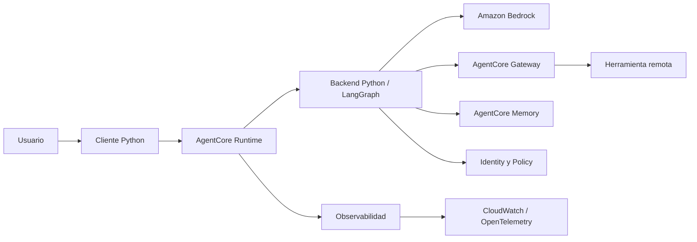

# Entrega: preparación de una cuenta AWS personal para AgentCore

**Capítulo:** 1  
**Proyecto:** `agentcore-study`  
**Entorno:** `learning`  
**Propietario:** `admin-bedrock`  
**Región de estudio:** `us-east-1`  
**Cuenta AWS:** `278655936591`  
**Perfil AWS:** `profile-admin-bedrock`  
**Fecha de inicio:** `2026-11-18`  
**Fecha de revisión:** `2026-11-30`

> Completa los campos entre `< >`. No incluyas access keys, tokens, secretos,
> correos personales ni payloads sensibles.

## 1. Objetivo de la aplicación

El asistente de políticas de viajes recibirá preguntas en lenguaje natural,
consultará información de políticas mediante herramientas autorizadas y
conservará únicamente el contexto permitido de cada usuario. LangGraph
orquestará el flujo del agente; Python implementará el backend y AgentCore
proporcionará ejecución, integración, memoria, seguridad, observabilidad y
evaluación.

En este capítulo se preparan la cuenta y las precondiciones. El agente todavía
no se despliega.

## 2. Arquitectura objetivo

### Componentes

| Componente | Uso en la solución | Capítulo de creación |
|---|---|---|
| Cliente Python | Invocar el agente | 2 |
| Backend Python / LangGraph | Orquestar el flujo | 2 |
| AgentCore Runtime | Ejecutar el backend | 2 |
| Amazon Bedrock | Inferencia del modelo | 1: validar acceso |
| AgentCore Gateway | Exponer herramientas | 3 |
| AgentCore Memory | Persistir contexto seleccionado | 4 |
| Identity | Identificar cliente y workload | 1 y 5 |
| Policy | Permitir o denegar acciones | 5 |
| Observabilidad | Logs, métricas y trazas | 5 |

## 3. Plano de control y plano de ejecución

| Plano | Operaciones | Identidad prevista | Evidencia |
|---|---|---|---|
| Control | Crear, configurar, versionar y eliminar recursos | `<admin-role>` | `<consola/comando>` |
| Ejecución | Invocar Runtime, Bedrock y recursos permitidos | `<execution-role>` | `<log/traza>` |

La identidad de ejecución no debe administrar recursos. La cuenta raíz no se
utiliza para invocaciones ni laboratorios.

## 4. Convención de nombres y etiquetas

### Nombres

| Recurso | Convención | Valor elegido |
|---|---|---|
| Rol administrativo | `agentcore-study-admin` | `<value>` |
| Rol de ejecución | `agentcore-study-execution` | `<value>` |
| Recursos AgentCore | `agentcore-study-learning-<component>` | `<value>` |
| Repositorio ECR | `agentcore-study-agent` | Se creará en capítulo 2 |

### Etiquetas

| Clave | Valor |
|---|---|
| `Project` | `agentcore-study` |
| `Environment` | `learning` |
| `Owner` | `<alias>` |
| `ManagedBy` | `manual` |
| `DeleteAfter` | `<yyyy-mm-dd>` |

## 5. Cuenta y seguridad

- [ ] MFA de la cuenta raíz activado.
- [ ] La cuenta raíz no se usa para el laboratorio.
- [ ] Identidad administrativa con MFA configurada.
- [ ] Región única seleccionada: `<aws-region>`.
- [ ] Perfil CLI seleccionado: `<profile-name>`.
- [ ] No existen credenciales en el repositorio.
- [ ] No existen credenciales en imágenes ni archivos de configuración
      versionados.

**Evidencia:** `<ruta de captura o comando sin datos sensibles>`

## 6. Presupuesto y control de consumo

| Elemento | Configuración |
|---|---|
| Nombre del presupuesto | `agentcore-study-budget` |
| Umbral mensual | `<amount> <currency>` |
| Umbral de alerta | `<percentage>` |
| Destinatario | `<configured/not configured>` |
| Fecha de revisión | `<yyyy-mm-dd>` |

- [ ] Alerta de presupuesto creada.
- [ ] Alerta probada o validada en Billing > Budgets.
- [ ] Cost Explorer revisado.
- [ ] Revisión de coste definida para cada sesión.

La alerta no detiene automáticamente los recursos. La limpieza se ejecuta
manualmente al terminar cada capítulo.

## 7. Acceso a Amazon Bedrock

| Campo | Resultado |
|---|---|
| Región | `<aws-region>` |
| Modelo seleccionado | `<model-id>` |
| Acceso visible en consola | `<yes/no/pending>` |
| Identidad que invocará | `<execution-role>` |
| Permisos concedidos | `<actions and resource scope>` |
| Prueba ejecutada | `<console/CLI/application>` |

- [ ] Modelo compatible con la región.
- [ ] Acceso solicitado o habilitado según la consola de Bedrock.
- [ ] Prueba mínima ejecutada sin guardar el prompt si contiene datos
      sensibles.
- [ ] Coste y límites revisados.

## 8. Identidades

### Identidad administrativa

| Campo | Valor |
|---|---|
| Nombre | `<admin-role-or-user>` |
| MFA | `<enabled>` |
| Uso | Crear, revisar y eliminar recursos |
| Uso prohibido | Invocar el agente en operación normal |

### Identidad de ejecución

| Campo | Valor |
|---|---|
| Nombre | `<execution-role>` |
| Servicio que la asume | `<confirmed-agentcore-service>` |
| Permisos de este capítulo | Invocar el modelo seleccionado |
| Permisos pendientes | Runtime, Gateway, Memory y observabilidad |
| Tags | `Project=agentcore-study`, `Environment=learning` |

No escribas aquí ARN completos si contienen información que no deba
compartirse; registra únicamente el identificador necesario para el curso.

## 9. Inventario de recursos

| Recurso | Servicio | Región | Identificador | Tags | Estado | Eliminar después |
|---|---|---|---|---|---|---|
| Presupuesto | Billing | Global | `agentcore-study-budget` | N/A | `<active>` | Sí, al finalizar curso |
| Rol admin | IAM | Global | `<id>` | `<tags>` | `<active>` | No, si se reutiliza |
| Rol ejecución | IAM | Global | `<id>` | `<tags>` | `<active>` | Sí, si es exclusivo |
| Acceso modelo | Bedrock | `<region>` | `<model-id>` | N/A | `<verified>` | Revocar si aplica |

## 10. Browser y Code Interpreter

**Decisión:** deshabilitados para este laboratorio.

**Motivo:** el caso solo requiere inferencia y capacidades que se crearán en
capítulos posteriores. No se necesita navegación web ni ejecución de código
generado.

## 11. Riesgos y límites

| Riesgo o límite | Mitigación | Estado |
|---|---|---|
| Coste inesperado | Presupuesto, región única y limpieza | `<status>` |
| Permisos excesivos | Rol de ejecución separado | `<status>` |
| Acceso a modelo no disponible | Validar región y modelo antes de Runtime | `<status>` |
| Secretos en repositorio | Perfil local/MFA y revisión antes de commit | `<status>` |
| Recursos olvidados | Tags, `DeleteAfter` e inventario | `<status>` |
| Datos reales en pruebas | Datos sintéticos únicamente | `<status>` |

## 12. Decisiones pendientes

- `<decisión, responsable y fecha>`
- `<decisión, responsable y fecha>`
- `<decisión, responsable y fecha>`

## 13. Verificación final

- [ ] `aws sts get-caller-identity --profile <profile-name>` validado.
- [ ] Región única registrada.
- [ ] Cuenta y perfil correctos confirmados.
- [ ] MFA activo.
- [ ] Presupuesto activo.
- [ ] Acceso al modelo validado.
- [ ] Roles separados y etiquetados.
- [ ] Inventario actualizado.
- [ ] Ningún secreto incluido en este documento.
- [ ] Ningún recurso inesperado creado.

## 14. Limpieza de esta actividad

- [ ] Eliminar presupuesto cuando termine el curso.
- [ ] Eliminar el rol de ejecución si no se reutilizará.
- [ ] Eliminar políticas exclusivas después de retirar asociaciones.
- [ ] Revocar credenciales temporales.
- [ ] Mantener MFA y la identidad administrativa principal.
- [ ] Confirmar en Billing y Cost Explorer que no hay consumo inesperado.

## 15. Resultado

**Estado:** `<pending/complete>`  
**Fecha:** `<yyyy-mm-dd>`  
**Revisado por:** `<alias>`  
**Observaciones:** `<notes>`
